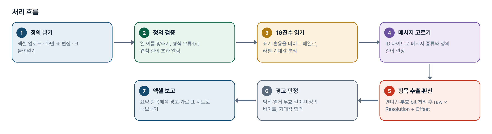
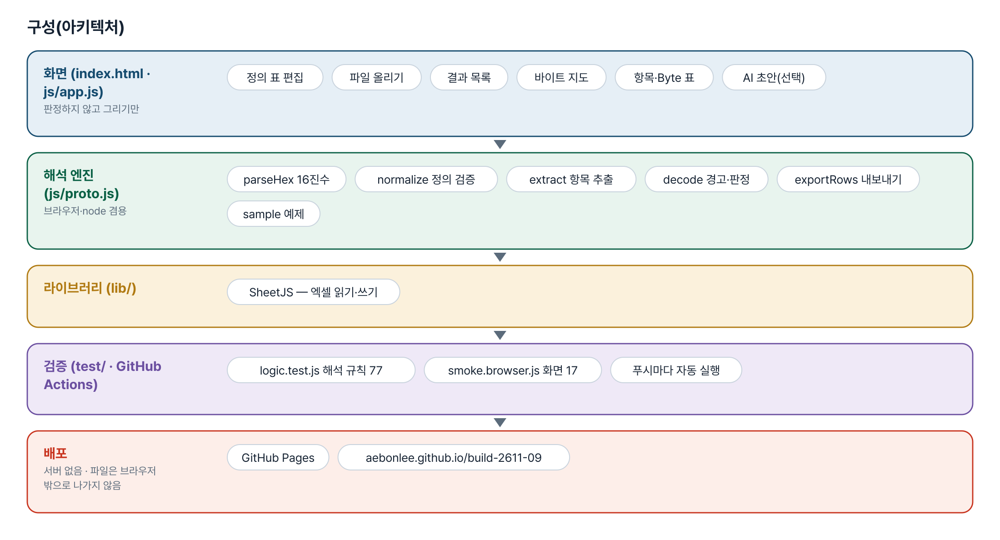
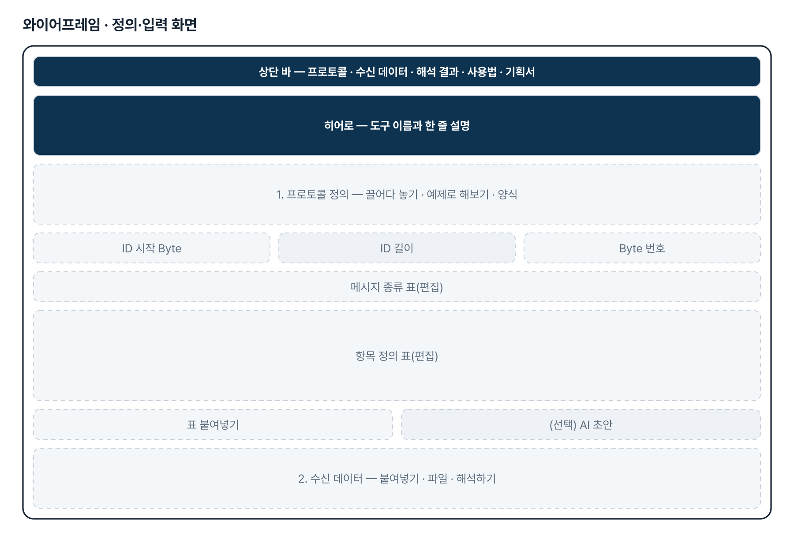
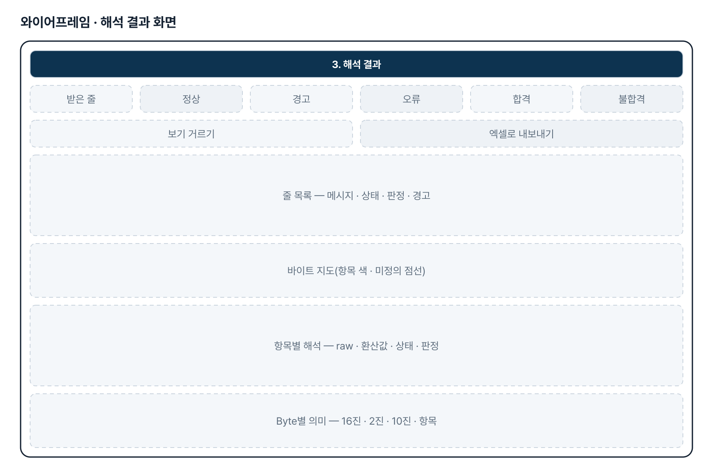
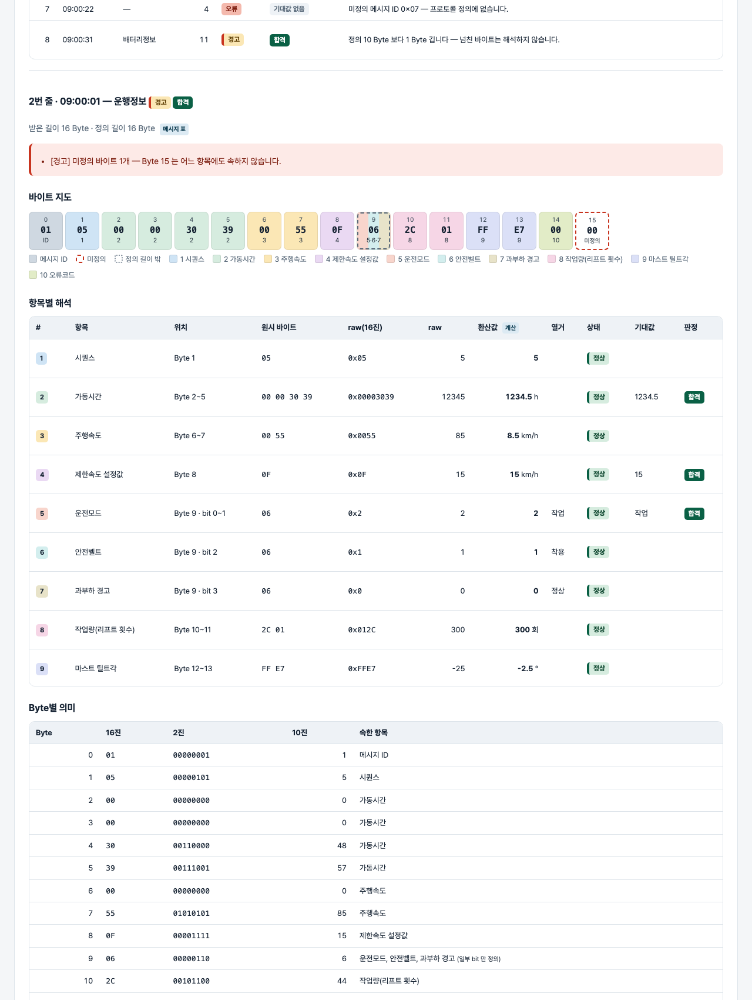

# 통신 프로토콜 16진수 해석기 — 프로젝트 기획서 v1.0

- 기획: 차준근 · 작성일 2026-11-02 · 생성형 AI 업무자동화 전문가과정 · 2차수 프로젝트 09
- 바로 쓰기: https://build-2611-09.jobability.co.kr/
- 워드 판: `docs/기획서/build-2611-09_차준근_통신프로토콜16진수해석기_기획서_v1.0.docx`

## 개요

프로토콜 정의 표와 서버에 받은 16진수 데이터를 넣으면 Byte별 의미와 환산값(raw × resolution + offset), 범위 이탈·길이 부족·미정의 바이트 경고, 바이트 지도, 기대값 합격·불합격을 한 번에 보여 주는 검증 도구입니다.

### 배경 · 현재 업무
- 원격통신모듈이 지게차의 가동시간·작업량·제한속도 설정값 등을 웹 서버(원격 모니터링 시스템)로 보냅니다.
- 서버에 받은 데이터는 16진수이고, 데이터 종류와 Byte 위치에 따라 의미가 다릅니다.
- 검증할 때마다 16진수를 프로토콜 문서와 일일이 대조하고 Resolution 으로 환산하는 일을 손으로 반복합니다.
- 반복 해석에 시간이 많이 들고 대조·계산 실수가 생깁니다.

### 목표
- 프로토콜 정의 표와 수신 데이터만 넣으면 항목별 실제값을 자동으로 계산합니다.
- Byte마다 어느 항목에 속하는지 바이트 지도로 보여 줍니다.
- 범위 이탈·길이 부족·미정의 바이트 등 전송 이상을 경고로 짚습니다.
- 기대값을 주면 합격·불합격을 판정하고 결과를 엑셀로 내보냅니다.

## 요구사항과 구현

| 기획서 요구 | 구현 |
|---|---|
| 수신 데이터와 프로토콜 문서 입력 | 정의: 엑셀 업로드 · 화면 표 편집 · 문서 표 붙여넣기 · (선택) AI 초안 / 데이터: 붙여넣기 · .txt·.csv·.xlsx |
| 16진수 데이터 해석 | 공백·콤마·0x·h 혼용, 붙여 쓰기, 여러 줄 일괄 |
| 데이터 종류와 Byte 위치에 따라 다른 의미 | 메시지 ID(위치·길이 설정)로 메시지 종류를 고르고 그 항목만 적용 |
| 데이터 위치·의미·환산식(Resolution) | 시작 Byte·bit, 길이, 빅·리틀 엔디언, 부호, Resolution·Offset, 단위, 열거값, 무효값 |
| 각 Byte 의 의미와 환산 결과 자동 도출 | 항목별 해석 표 · Byte별 의미 표 · 바이트 지도 |
| 정상 전송 검증 | 경고 7종 + 기대값 합격·불합격 판정 |
| 해석 오류 감소 | 정의 검증(형식·bit 겹침·길이 초과), 해석 규칙은 테스트로 고정 |

## 주요 기능

- **프로토콜 정의** — 엑셀(프로토콜·메시지·설정·수신데이터 시트)을 읽거나 화면 표에서 고칩니다. 고치면 바로 다시 해석합니다. 열 이름이 조금 달라도 읽습니다.
- **16진수 읽기** — 한 줄에 메시지 하나. 라벨(줄 앞 「라벨 |」)과 기대값(줄 뒤 「=> 항목=값」)을 붙일 수 있습니다.
- **환산·경고** — raw × Resolution + Offset. 미정의 메시지 ID · 길이 부족 · 정의보다 긺 · 미정의 바이트 · 범위 이탈 · 열거표 밖 · 무효값.
- **바이트 지도** — Byte마다 항목 색과 번호를 칠하고, 미정의 바이트는 빨간 점선으로 표시합니다. Byte별 16진·2진·10진 표도 함께 보여 줍니다.
- **합격 판정** — 숫자는 허용오차(기본 Resolution/2), 글자는 열거 이름, 0x 값은 raw 와 비교합니다.
- **엑셀 내보내기** — 메시지요약 · 항목해석 · 경고목록 · 메시지별 가로 표 · 정의 사본 시트를 만듭니다.
- **(선택) AI 정의표 초안** — 문장으로 된 문서를 정의표 초안으로 바꿉니다. 「AI 초안 — 검토 필요」로 따로 보이고 보내기 전 확인합니다.

## 처리 흐름(파이프라인)

1. **정의 넣기** — 엑셀 업로드 · 화면 표 편집 · 표 붙여넣기
2. **정의 검증** — 열 이름 맞추기, 형식 오류·bit 겹침·길이 초과 알림
3. **16진수 읽기** — 표기 혼용을 바이트 배열로, 라벨·기대값 분리
4. **메시지 고르기** — ID 바이트로 메시지 종류와 정의 길이 결정
5. **항목 추출·환산** — 엔디언·부호·bit 처리 후 raw × Resolution + Offset
6. **경고·판정** — 범위·열거·무효·길이·미정의 바이트, 기대값 합격
7. **엑셀 보고** — 요약·항목해석·경고·가로 표 시트로 내보내기

## 구성(아키텍처)

- **화면 (index.html · js/app.js)** — 정의 표 편집 · 파일 올리기 · 결과 목록 · 바이트 지도 · 항목·Byte 표 · AI 초안(선택)
- **해석 엔진 (js/proto.js)** — parseHex 16진수 · normalize 정의 검증 · extract 항목 추출 · decode 경고·판정 · exportRows 내보내기 · sample 예제
- **라이브러리 (lib/)** — SheetJS — 엑셀 읽기·쓰기
- **검증 (test/ · GitHub Actions)** — logic.test.js 해석 규칙 77 · smoke.browser.js 화면 17 · 푸시마다 자동 실행
- **배포** — GitHub Pages · aebonlee.github.io/build-2611-09

## 화면 구성(와이어프레임)

## 규칙 · 판정 기준

- Byte 번호는 설정에 따라 0 또는 1 부터 셉니다.
- 바이트 항목은 시작 Byte 부터 길이만큼을 바이트 순서대로 붙여 읽습니다(빅 = 앞 바이트가 상위, 리틀 = 앞 바이트가 하위).
- bit 항목은 걸친 바이트를 붙인 정수의 최하위 bit 에서 시작 bit 만큼 건너뛰어 읽습니다.
- 부호 있음은 2의 보수. 환산값 = raw × Resolution + Offset, 소수 자릿수로 반올림합니다.
- 무효값은 환산하지 않습니다. 메시지 길이가 비면 항목 끝에서 계산하고 출처를 따로 표시합니다.
- 기대값: 숫자는 허용오차(기본 Resolution/2), 글자는 열거 이름, 0x 값은 raw 와 비교합니다.

## 검증

- 계산 규칙 테스트 77개 · 화면 연기 테스트 17개 통과
- 예제 값은 손으로 계산한 값(0x3039 × 0.1 = 1234.5, 0xFFE7 부호 있음 = −25 → −2.5° 등)과 대조합니다.
- 되돌려 확인: 리틀엔디언 처리를 빼면 4개, 허용오차 기본값을 0 으로 하면 1개, 반올림을 빼면 2개가 실패합니다.
- 화면 테스트: 예제 → 결과 7줄 → 바이트 지도 → 경고 3종 → 정의 표 접힘·수정 재해석 → 엑셀 왕복 → 360px.

## 이번 판에서 하지 않는 것

- 서버 실시간 수신 연동은 하지 않습니다(받은 데이터를 붙여넣거나 파일로 올림).
- 체크섬·CRC, 분할 전송, 가변 길이 메시지는 이번 판에서 다루지 않습니다.
- PDF·워드 프로토콜 문서를 자동으로 읽지 않습니다 — 표 붙여넣기 또는 AI 초안으로 대신합니다.

## 다음 단계

- 체크섬(XOR·SUM·CRC16) 항목 종류
- 줄별 추이 그래프와 순서 규칙(가동시간 감소 경고)
- 시퀀스 번호 빠짐·중복 검사
- DBC·CSV 프로토콜 파일 직접 읽기

## 버전 이력

- **v1.0** (2026-11-02) — 첫 판 — 16진수 해석·환산·경고 7종·바이트 지도·기대값 판정·엑셀 내보내기 / 기획서 워드 판·파이프라인·아키텍처·와이어프레임 추가
